<p align="center">
  <picture>
    <source media="(prefers-color-scheme: dark)" srcset="docs/assets/banner-hero-dark.svg">
    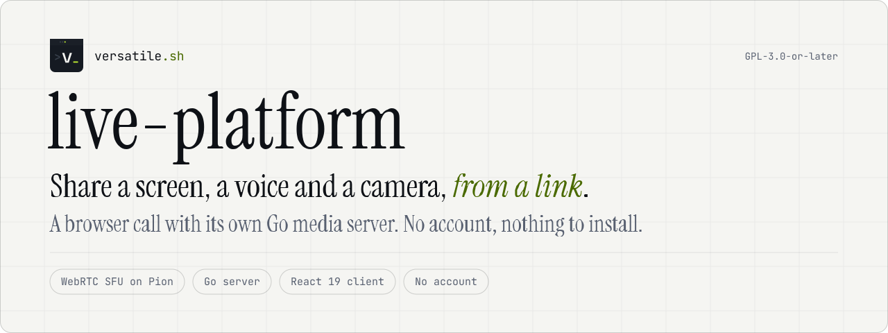
  </picture>
</p>

<p align="center">
  <a href="https://github.com/versatile-sh/live-platform/actions/workflows/ci.yml"></a>
  
  
  
</p>

<p align="center">
  <b><a href="#install-and-run">Install</a></b> &nbsp;·&nbsp;
  <b><a href="#usage">Usage</a></b> &nbsp;·&nbsp;
  <a href="#how-it-works">How it works</a> &nbsp;·&nbsp;
  <a href="https://live.versatile.sh">live.versatile.sh</a>
</p>

**live** is a browser call for sharing a screen, a voice and a camera from a link. No account, nothing to install: pick a name, send the link, talk. One Go binary runs the page, the signalling and its own WebRTC SFU on [Pion](https://github.com/pion/webrtc); the client is React 19 with Vite and Tailwind 4.

<a id="what-it-is"></a>

<picture>
  <source media="(prefers-color-scheme: dark)" srcset="docs/assets/section-what-it-is-dark.svg">
  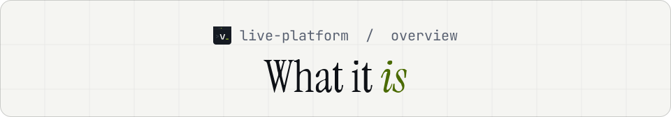
</picture>

live is for people who need to show something to someone right now: a pair-programming session, a game night, a quick look at a screen, a call with a friend who has no account anywhere. The room is the address, `https://live.versatile.sh/{room}`, and whoever opens a free name owns that room.

What exists today:

live is for people who need to show something to someone right now: a pair-programming session, a game night, a quick look at a screen, a call with a friend who has no account anywhere. The room is the address, `https://live.versatile.sh/{room}`, and whoever opens a free name owns that room.

What exists today:

| Area | What you get |
| --- | --- |
| **Rooms** | Rooms by name, up to 10 people. A room is released 30 seconds after the last person leaves. Public rooms let in anyone with the link; private rooms ask for a room code. Either kind can be listed in the open rooms, with its country on a map. |
| **Media** | Microphone, camera, screen with the computer's sound, push to talk, camera and screen quality, background blur, a volume slider and mute for each shared screen's sound. |
| **Voice** | Three voice filters with echo cancellation, gain, balanced voice and a noise gate; the strongest adds RNNoise. All of it runs in the browser. A lime outline marks whoever is speaking. |
| **Together** | Chat with links, emoji, GIFs and private messages; raised hand; a shared whiteboard ([Excalidraw](https://github.com/excalidraw/excalidraw)); a people list; per-person choice of what to see. |
| **Owner controls** | Transfer ownership, remove, ban, mute everyone and let people speak by raised hand, change the room's access and listing. |
| **Comfort** | A stage grid that always fits the screen, a thin rail for everyone beside the one in front (`Ctrl+Alt+O`), a floating window of the call (Document Picture-in-Picture), a command search on `Ctrl+K`, live connection figures (route, delay, loss, jitter, rates, codecs). |
| **Presence** | No ghosts: a closed tab, a dead socket or a lost network removes the participant. The server decides who is in the room; browsers only report. |
| **Languages** | English and Portuguese, taken from the browser and kept once chosen. |


It is not a recording or transcription product, and it has no end-to-end encryption yet: see [Security and privacy](docs/security.md).

| For | You get | Start with |
|---|---|---|
| **People who call** | a room from a link, in the browser | [live.versatile.sh](https://live.versatile.sh) |
| **Operators** | one container, no database | [Install and run](#install-and-run), [Self-hosting](docs/self-hosting.md) |

<a id="documentation"></a>

<picture>
  <source media="(prefers-color-scheme: dark)" srcset="docs/assets/section-documentation-dark.svg">
  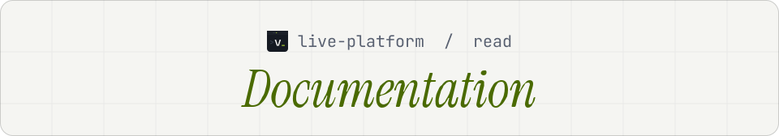
</picture>

| Read | To |
|---|---|
| [Architecture](docs/architecture.md) | server layout, the `lv.1` protocol, presence, media, whiteboard |
| [Security and privacy](docs/security.md) | room codes, hardening, what is not built yet, what is kept |
| [Configuration](docs/configuration.md) | every environment variable |
| [Self-hosting](docs/self-hosting.md) | running it behind your own proxy |
| [Screen sound](docs/screen-audio.md) | sharing the computer's sound with a screen |

The design rules are in [`web/DESIGN.md`](web/DESIGN.md). Engineering documentation, the product vocabulary included, is kept by Versatile outside this repository.

<a id="how-it-works"></a>

<picture>
  <source media="(prefers-color-scheme: dark)" srcset="docs/assets/section-how-dark.svg">
  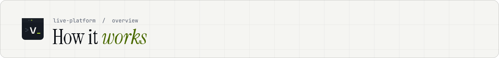
</picture>

<picture>
  <source media="(prefers-color-scheme: dark)" srcset="docs/assets/diagram-components-dark.svg">
  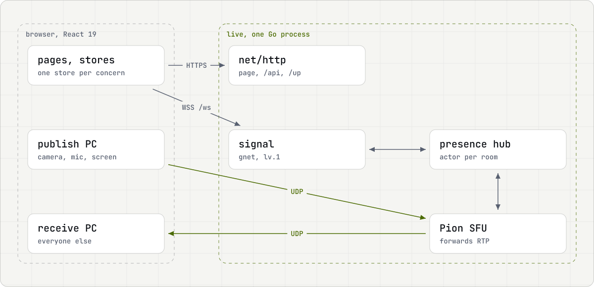
</picture>

<picture>
  <source media="(prefers-color-scheme: dark)" srcset="docs/assets/diagram-join-dark.svg">
  
</picture>

1. The browser loads the page and calls the API over HTTP, then opens one WebSocket (subprotocol `lv.1`) for presence, chat, owner actions and the offer and answer of each peer connection.
2. The presence hub keeps one goroutine per room. The server alone decides who is in the room; browsers only report.
3. Each participant publishes over one peer connection and receives over another. The Pion SFU forwards the media to the others without decoding it.

<a id="install-and-run"></a>

<picture>
  <source media="(prefers-color-scheme: dark)" srcset="docs/assets/section-install-dark.svg">
  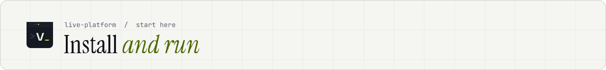
</picture>

Needs Go 1.27.4, Node.js 26 and a browser with WebRTC. Two terminals; the Vite dev server proxies `/api` to `127.0.0.1:8080` and `/ws` to `127.0.0.1:8081`.

```sh
cd server
PUBLIC_ORIGIN=http://localhost:5173 go run ./cmd/live

cd web
npm ci
npm run dev        # http://localhost:5173
```

The server ends its start with:

```text
"msg":"listening","http":"127.0.0.1:8080","signal":"127.0.0.1:8081"
```

Open `http://localhost:5173/any-name` in two tabs to try a call.

To build and serve everything from one binary:

```sh
cd web && npm ci && npm run build
cd ../server && CGO_ENABLED=0 go build -trimpath -o live ./cmd/live
WEB_DIR=../web/dist ./live        # page and API on :8080; GET /up answers 200
```

Without `WEB_DIR` the server answers the API only. The binary serves the page and the signalling on different ports, so in front of a browser put both behind one origin ([Self-hosting](docs/self-hosting.md)).

A Docker image is built from the `Dockerfile` (`docker build -t live .`): it runs the static binary on distroless as non-root with `PORT=3000`, `SIGNAL_PORT=3001` and `WEB_DIR=/web`.

<a id="usage"></a>

<picture>
  <source media="(prefers-color-scheme: dark)" srcset="docs/assets/section-use-dark.svg">
  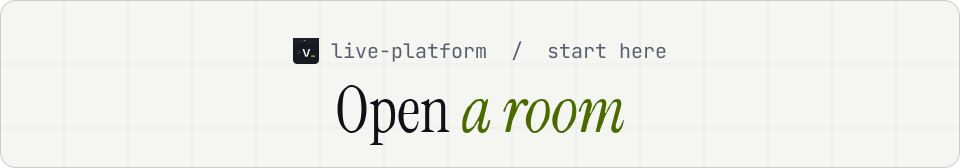
</picture>

1. **Open a room.** Go to [live.versatile.sh](https://live.versatile.sh), type a name and enter. A free name creates the room and makes you its owner. Before entering you choose its access: public or private, listed in the open rooms or not.
2. **Send the link.** Anyone with `https://live.versatile.sh/{room}` can come in. They type a name at the doorway, and the room code if the room is private.
3. **Private rooms.** A room code looks like `8ABH-23HK`: eight capitals and digits, drawn at random in your browser or chosen by you. A shared link can carry the code after `#` (`/{room}#8ABH-23HK`), the part of an address browsers never send to a server. Ten wrong attempts close the door for five minutes.
4. **Open rooms.** [`/lobby`](https://live.versatile.sh/lobby) lists the rooms their owners chose to show, public or private, with a map of where they are.
5. **Run the room.** As the owner you can transfer the room, remove or ban someone, mute everyone and give the word by raised hand, or switch the room between public and private.
6. **Leave.** Close the tab or press leave. When the last person is gone, the room is released 30 seconds later and its name is free again.


Sharing the computer's sound with a screen: [Screen sound](docs/screen-audio.md).

**From Discord.** [Add the bot to your server](https://live.versatile.sh/bot/install) and it sends people to a room with an invitation link. An invitation can carry a guest pass (`?pass=<id>`) that fills in the person's name and photo and chooses the room's access. Entering with it hands the browser a fresh pass for the same room, so the person can leave and come back with the same photo and Discord origin. The bot is a separate product; this repository holds only the page and the server side that read its passes.

<a id="configuration"></a>

<picture>
  <source media="(prefers-color-scheme: dark)" srcset="docs/assets/section-configuration-dark.svg">
  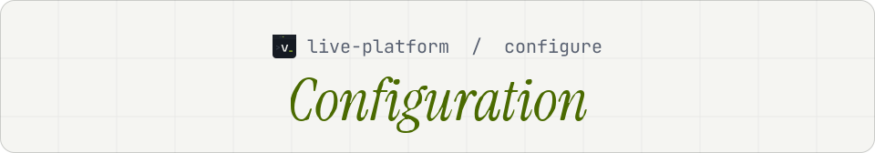
</picture>

Everything is read from the environment at start. The main variables:

| Variable | Default | What it does |
|---|---|---|
| `PORT` | `8080` (`3000` in the image) | HTTP: page, API and `/up`. |
| `SIGNAL_PORT` | `8081` (`3001` in the image) | Signalling WebSocket (`/ws`). |
| `PUBLIC_ORIGIN` | empty | Origins allowed to open the socket, comma separated. Empty allows only the request's own host. |
| `WEB_DIR` | empty (`/web` in the image) | Directory of the built client. Empty serves the API only. |
| `MEDIA_UDP_PORT` | `0` | One UDP port shared by all media. `0` lets each connection pick its own. |
| `AUDIT_DIR` | empty | Directory of the audit trail. Empty turns it off. |

All variables: [Configuration](docs/configuration.md).

<a id="development-and-tests"></a>

<picture>
  <source media="(prefers-color-scheme: dark)" srcset="docs/assets/section-development-and-tests-dark.svg">
  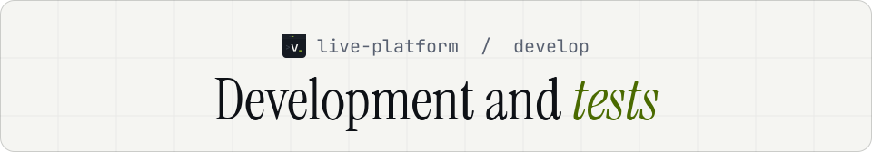
</picture>

```sh
mise install                           # the pinned Go, golangci-lint, vlint and revive
lefthook install                       # once: fast lint on commit, changed-package lint on push
mise run check                         # gofmt, go vet, go-lint, golangci-lint, then the race tests
mise run lint                          # the pre-push tier: lint of the packages changed since origin/main
mise run lint-full                     # the full lint tier on everything, as check runs it
mise run test                          # go test -race -count=1 ./...
cd web && npx vitest run
cd web && npm run test:live            # the client against a real server
cd web && npm run typecheck && npm run build
```

Tests assert what a person or a peer can observe: what is on the page, what goes over the socket, who is in the room after a failure. CI also runs `govulncheck` and builds the image.

<a id="security"></a>

<picture>
  <source media="(prefers-color-scheme: dark)" srcset="docs/assets/section-security-dark.svg">
  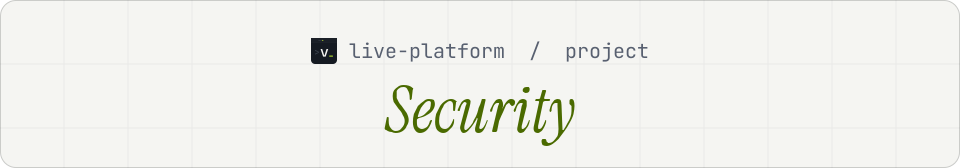
</picture>

Never expose room codes, audit files or the guest-pass key. Found a vulnerability? Do not open a public issue; report it as [`SECURITY.md`](SECURITY.md) says. Details and what is not built yet: [Security and privacy](docs/security.md).

<a id="contributing"></a>

<picture>
  <source media="(prefers-color-scheme: dark)" srcset="docs/assets/section-contributing-dark.svg">
  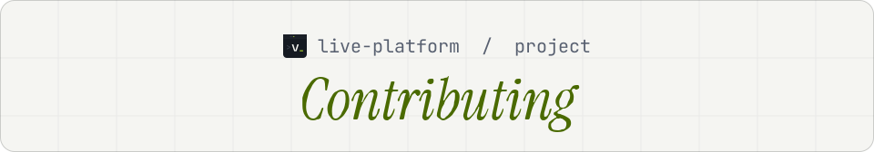
</picture>

Issues and pull requests are welcome. Branch from `main`, one concern per pull request, and keep `mise run check` green.

<a id="license"></a>

<picture>
  <source media="(prefers-color-scheme: dark)" srcset="docs/assets/section-license-dark.svg">
  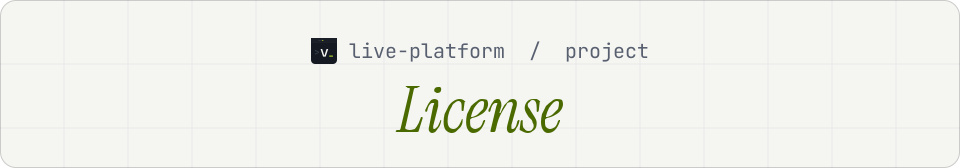
</picture>

Copyright (C) 2026 Versatile (versatile.sh)

live-platform is free software: you can redistribute it and/or modify it under the terms of the GNU General Public License as published by the Free Software Foundation, either version 3 of the License, or (at your option) any later version. See [LICENSE](LICENSE).

For a commercial licence without the GPL's obligations, contact Versatile through [versatile.sh/contact](https://versatile.sh/contact).

Contributions are accepted under the CLA, see [CONTRIBUTING.md](CONTRIBUTING.md).
