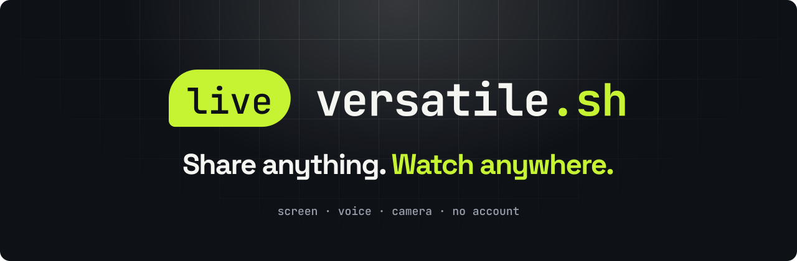
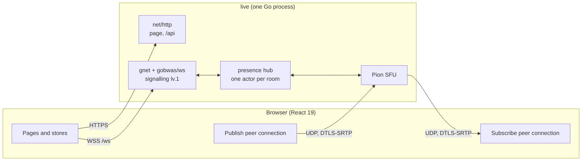

<a href="https://live.versatile.sh">
  <picture>
    <source media="(prefers-color-scheme: light)" srcset="./.github/assets/banner-light.svg">
    
  </picture>
</a>

<p align="center">
  <a href="https://versatile.sh">
    <picture>
      <source media="(prefers-color-scheme: light)" srcset="./.github/assets/versatile-logo-light.svg">
      
    </picture>
  </a>
</p>

<p align="center">
  <a href="https://live.versatile.sh"><b>live.versatile.sh</b></a>
  &nbsp;·&nbsp;
  <a href="https://live.versatile.sh/lobby">Open rooms</a>
  &nbsp;·&nbsp;
  <a href="https://live.versatile.sh/bot/install">Discord bot</a>
  &nbsp;·&nbsp;
  <a href="https://live.versatile.sh/privacy">Privacy</a>
  &nbsp;·&nbsp;
  <a href="https://versatile.sh">versatile.sh</a>
</p>

<p align="center">
  <a href="https://github.com/versatile-sh/live-platform/actions/workflows/ci.yml"></a>
  
  
  
</p>

**live** is a browser call for sharing a screen, a voice and a camera from a link. No account, nothing to install: pick a name, send the link, talk. One Go binary runs the page, the signalling and its own WebRTC SFU on [Pion](https://github.com/pion/webrtc); the client is React 19 with Vite and Tailwind 4.

## Contents

- [About](#about)
- [How to use](#how-to-use)
- [How it works](#how-it-works)
- [Security and privacy](#security-and-privacy)
- [Install and run](#install-and-run)
- [Configuration](#configuration)
- [Self-hosting](#self-hosting)
- [Contributing](#contributing)
- [License](#license)

## About

live is for people who need to show something to someone right now: a pair-programming session, a game night, a quick look at a screen, a call with a friend who has no account anywhere. The room is the address, `https://live.versatile.sh/{room}`, and whoever opens a free name owns that room.

What exists today:

| Area | What you get |
| --- | --- |
| **Rooms** | Rooms by name, up to 10 people. A room is released 30 seconds after the last person leaves. Public rooms let in anyone with the link; private rooms ask for a room code. Either kind can be listed in the open rooms, with its country on a map. |
| **Media** | Microphone, camera, screen with the computer's sound, push to talk, camera and screen quality, background blur, a volume slider and mute for each shared screen's sound. |
| **Voice** | Three voice filters with echo cancellation, gain, balanced voice and a noise gate; the strongest adds RNNoise. All of it runs in the browser. A lime outline marks whoever is speaking. |
| **Together** | Chat with links, emoji, GIFs and private messages; raised hand; a shared whiteboard ([Excalidraw](https://github.com/excalidraw/excalidraw)); a people list; per-person choice of what to see. |
| **Owner controls** | Transfer ownership, remove, ban, mute everyone and let people speak by raised hand, change the room's access and listing. |
| **Comfort** | A stage grid that always fits the screen, a thin rail for everyone beside the one in front (`Ctrl+Alt+O`), a floating window of the call (Document Picture-in-Picture), a command search on `Ctrl+K`, live connection figures (route, delay, loss, jitter, rates, codecs). |
| **Presence** | No ghosts: a closed tab, a dead socket or a lost network removes the participant. The server decides who is in the room; browsers only report. |
| **Languages** | English and Portuguese, taken from the browser and kept once chosen. |

## How to use

1. **Open a room.** Go to [live.versatile.sh](https://live.versatile.sh), type a name and enter. A free name creates the room and makes you its owner. Before entering you choose its access: public or private, listed in the open rooms or not.
2. **Send the link.** Anyone with `https://live.versatile.sh/{room}` can come in. They type a name at the doorway, and the room code if the room is private.
3. **Private rooms.** A room code looks like `8ABH-23HK`: eight capitals and digits, drawn at random in your browser or chosen by you. A shared link can carry the code after `#` (`/{room}#8ABH-23HK`), the part of an address browsers never send to a server. Ten wrong attempts close the door for five minutes.
4. **Open rooms.** [`/lobby`](https://live.versatile.sh/lobby) lists the rooms their owners chose to show, public or private, with a map of where they are.
5. **Run the room.** As the owner you can transfer the room, remove or ban someone, mute everyone and give the word by raised hand, or switch the room between public and private.
6. **Leave.** Close the tab or press leave. When the last person is gone, the room is released 30 seconds later and its name is free again.

### The computer's sound with a screen

Chrome and Edge send the whole computer's sound with a screen on Windows and on macOS 14.2 or later: choose *Entire screen* and tick *Share system audio*. Firefox and Safari send no computer sound. On Linux, Chrome sends only a tab's sound; the helper [`screen-audio.sh`](web/public/assets/screen-audio.sh) uses `pactl` (PulseAudio or PipeWire, no root) to route the desktop's sound into a device the page can share:

```sh
curl -fsSL https://live.versatile.sh/assets/screen-audio.sh -o ~/.local/bin/screen-audio && chmod +x ~/.local/bin/screen-audio
screen-audio on     # before sharing
screen-audio off    # gives the sound back to the original device
```

In a call, the screen button's menu shows a guide for your system when a screen goes out without its sound.

### From Discord

[Add the bot to your server](https://live.versatile.sh/bot/install) and it sends people to a room with an invitation link. An invitation can carry a guest pass (`?pass=<id>`) that fills in the person's name and photo and chooses the room's access. The bot is a separate product; this repository holds only the page and the server side that read its passes.

## How it works

### Architecture



One binary, three listeners:

| Listener | Library | Carries |
| --- | --- | --- |
| HTTP (`PORT`) | `net/http` | the built client, `GET /api/rooms/{slug}`, `GET /api/lobby`, `GET /api/project`, `GET /api/pass/{id}`, `GET /up` |
| Signalling (`SIGNAL_PORT`) | [gnet](https://github.com/panjf2000/gnet) with [gobwas/ws](https://github.com/gobwas/ws) | WebSocket at `/ws`, subprotocol `lv.1`: presence, chat, whiteboard, owner actions, SDP and ICE |
| Media (`MEDIA_UDP_PORT`) | [Pion WebRTC](https://github.com/pion/webrtc) | RTP over DTLS-SRTP, straight from the browser to the server |

| Part | Choice | Why |
| --- | --- | --- |
| Media | Our own SFU on Pion, for every room | A mesh costs each person one upload per listener; a hosted SFU puts the media on someone else's server. |
| Signalling | gnet event loop | Holds many idle sockets cheaply. It carries signalling only; media and HTTP use the tools made for them. |
| Page and API | `net/http` | Nothing here needs more. |
| Client | React 19, Vite, TypeScript, Tailwind 4; no router, no state library | Three pages and one store per concern do not need them. |

### Server layout

The server follows ports and adapters; dependencies point inward.

```
server/
  cmd/live/                 composition root: reads the environment, wires everything; `live audit` reads the audit trail
  internal/
    domain/room/            the Room aggregate: seats, flags, roster, owner rules. Pure: no clock, no I/O
    domain/shared/          small shared value types
    application/presence/   the hub and one goroutine (actor) per room; liveness, handover, lobby summaries
    ports/inbound|outbound/ what the application offers and what it needs
    adapters/
      signal/               lv.1 over WebSocket on gnet: frames, close codes, rate limits
      httpapi/              JSON routes
      page/                 serves the built client with its security headers
      sfu/                  the Pion media engine
      handoff/              hands rooms to the next process on a planned restart
      guestpass/            takes guest passes from a configured issuer
      audit/                optional append-only audit trail
      clientinfo/           parses User-Agent and request headers for the audit trail
      github/               the repository star count on the front page
    integration/            end-to-end calls against a real server
```

- **One goroutine per room.** Every change to a room goes through its actor, in order; there are no locks around room state. The room is a value that is told the time and answers with what changed, so every presence rule is a plain unit test.
- **State as bits.** Seats are a `uint64` bitmap; what a participant has on (microphone, camera, screen, screen audio, hand, owner, unstable) is a `uint16` of flags.
- **Whole rosters, versioned.** Each change sends the entire roster with a version number, never a diff. A browser that missed a message is right again at the next one.
- **The lobby never waits.** Each room publishes an atomic summary; listing open rooms never blocks on a room's goroutine.

The client lives in `web/src`, one folder per concern (`room/`, `media/`, `signal/`, `session/`, `lobby/`, `board/`, `domain/`, `ui/`, `i18n/`). The design system, its tokens and shapes are in [`web/DESIGN.md`](web/DESIGN.md); the product's vocabulary is in [`CONTEXT.md`](CONTEXT.md).

### Protocol at a glance (`lv.1`)

JSON text frames over one WebSocket, each with a type in `t`.

| Direction | Frames |
| --- | --- |
| Browser to server | `join`, `resume`, `hb` (heartbeat), `leave`, `media`, `rtc` (SDP/ICE), `look`, `photo`, `chat`, `board`, owner actions (`owner`, `remove`, `ban`, `transfer`, `listed`, `password`) |
| Server to browser | `joined` (seat, generation, resume secret), `roster` (versioned, whole), `rtc`, `chat`, `photo`, `board`, `error` |

Application close codes tell the browser why a socket ended: `4001` superseded by another tab, `4012` server restarting, `4400` bad frame, `4401` no hello, `4403` removed, `4404` banned, `4408` silent, `4409` too slow to read, `4429` flooding.

### Presence: no ghosts

The server is the only authority on who is present. It watches three signals: the socket, a heartbeat and the media path. At the first missed signal the others see the participant as *unstable*; after a 4 second grace they are *reconnecting*; a participant who does not come back is removed. Leaving on purpose is immediate.

A reload keeps the seat: the browser holds a per-room secret for the tab's lifetime and presents it to `resume`. The secret rotates on every resume and the old one is refused.

On a planned restart, a stopping server can write its rooms to a directory shared with the next one (`HANDOVER_DIR`); the new process adopts them and holds each seat for 12 seconds while the browsers reconnect. A crash loses the rooms.

### Media

- **Two peer connections per participant**: one to publish, one to receive everyone else. The server forwards RTP without decoding it and names each forwarded track by who sent it and what it is, from the sources the publisher declared (microphone, camera, screen, screen sound).
- **Codecs** are Pion's defaults; the server asks publishers for a keyframe every 2 seconds so late joiners get a picture quickly.
- **No simulcast and no forwarding on demand** yet: every stream goes to everyone at the quality it was sent.
- **Audio processing is in the browser only**: RNNoise for the strong voice filter, plus gain, a noise gate and echo cancellation. Background blur runs MediaPipe in the browser. The server never processes audio or video.
- **Media path**: one UDP port for everyone when `MEDIA_UDP_PORT` is set, announced at `MEDIA_PUBLIC_IP`. There is no TURN relay, so a network that blocks UDP cannot carry media.

### Whiteboard

Excalidraw, pinned and bundled, loaded only when opened. The board lives in the browsers; the server relays its pieces without reading them and keeps nothing, so it is gone when the room empties.

## Security and privacy

### Room codes

In a private room the browser derives 64 bytes from the room code with **PBKDF2-SHA-256, 600,000 iterations**, salted with the room's address. The first 32 bytes are a verifier, sent to the server, which stores only its SHA-256. The other 32 are reserved as a media key and never leave the browser. A link carries the code after `#`, which browsers do not send. Ten wrong attempts lock the door for five minutes.

### Hardening

- **Content Security Policy**: `default-src 'none'`; scripts, styles, fonts and connections only from the page's own origin; no inline script or style. `'wasm-unsafe-eval'` is allowed for the voice filter and background blur, which compile WebAssembly from our own files.
- **Signalling limits**: 128 KiB per frame, 2 MiB of unsent data, 20 frames per second with a burst of 80. A client past them is disconnected with a close code that says why. The socket accepts only the configured origins.
- **Supply chain**: exact versions and committed lockfiles, npm install scripts disabled, base images and CI actions pinned by digest, Dependabot on Go, npm, Docker and Actions. CI runs `govulncheck`, `go mod verify`, `npm audit signatures` and `npm audit`, and publishes a CycloneDX SBOM for the server and the client.
- **Image**: distroless, static, non-root.

### What is not built yet

Stated plainly, because an open project is only as safe as what it admits:

- **No end-to-end encryption.** Media is encrypted between each browser and the server (DTLS-SRTP), and the server could read it. Chat, private messages and the whiteboard pass through the server in clear. The media key derived from a room code is reserved for this and not used yet.
- **No TURN relay.** A participant whose network blocks UDP has no media.
- **No simulcast or forwarding on demand.** Every stream reaches everyone, including streams a participant chose to hide.
- **Rooms do not survive a crash**, only a planned handover.
- Not built: recording, transcription, extensions.

### Privacy

The in-app page [/privacy](https://live.versatile.sh/privacy) tells visitors what is kept. In short: without `AUDIT_DIR` the server records nothing. With it, the server appends one JSON line per fact (room created, join, leave, chat, owner action, room ended) to a daily file and deletes files older than `AUDIT_RETENTION_DAYS`. A public room's chat text is recorded; a private room's chat keeps who, when and the length, never the content. The metrics log line carries counts only, and joins and leaves are logged without address, name or text.

## Install and run

### Prerequisites

| Tool | Version | From |
| --- | --- | --- |
| Go | 1.27.4 | `server/go.mod` |
| Node.js | 26 | `Dockerfile`, CI |
| npm | the one shipped with Node 26 | `web/package-lock.json` |
| Docker | any recent version | optional, for the image |

A browser with WebRTC: current Chrome, Edge, Firefox or Safari.

### Run locally

Two terminals. The Vite dev server proxies `/api` to `127.0.0.1:8080` and `/ws` to `127.0.0.1:8081`.

```sh
# 1. the server: page and API on :8080, signalling on :8081, media on random UDP ports
cd server
PUBLIC_ORIGIN=http://localhost:5173 go run ./cmd/live

# 2. the client, with hot reload
cd web
npm ci
npm run dev        # http://localhost:5173
```

Open `http://localhost:5173/any-name` in two tabs to try a call.

### Build

```sh
cd web && npm ci && npm run build                    # client into web/dist
cd server && CGO_ENABLED=0 go build -trimpath -o live ./cmd/live
WEB_DIR=../web/dist ./live                           # serves the client and the API on :8080
```

Without `WEB_DIR` the server answers the API only. The binary serves the page and the signalling on different ports; in front of a browser, put both behind one origin (see [Self-hosting](#self-hosting)).

### Test

```sh
cd server && go vet ./... && go test -race ./...    # domain, application, adapters, integration
cd web && npx vitest run                             # pages, stores and design rules (jsdom)
cd web && npm run test:live                          # the client against a real server
cd web && npm run typecheck && npm run build
```

Tests assert what a person or a peer can observe: what is on the page, what goes over the socket, who is in the room after a failure.

### Docker

```sh
docker build -t live .
docker run --rm \
  -p 3000:3000 -p 3001:3001 -p 50000:50000/udp \
  -e PUBLIC_ORIGIN=https://live.example.com \
  -e MEDIA_UDP_PORT=50000 -e MEDIA_PUBLIC_IP=203.0.113.10 \
  live
curl -fsS localhost:3000/up
```

The image builds the client and a static server binary, then runs them on distroless as non-root with `HOST=0.0.0.0`, `PORT=3000`, `SIGNAL_PORT=3001` and `WEB_DIR=/web`.

## Configuration

Everything is read from the environment at start.

| Variable | Default | Meaning |
| --- | --- | --- |
| `HOST` | `127.0.0.1` (`0.0.0.0` in the image) | Address the HTTP and signalling listeners bind to. |
| `PORT` | `8080` (`3000` in the image) | HTTP: page, API and `/up`. |
| `SIGNAL_PORT` | `8081` (`3001` in the image) | Signalling WebSocket (`/ws`). |
| `PUBLIC_ORIGIN` | empty | Origins allowed to open the socket, comma separated. Empty allows only the request's own host. |
| `WEB_DIR` | empty (`/web` in the image) | Directory of the built client. Empty serves the API only. |
| `WEB_LIVE_DIR` | empty | A directory laid over `WEB_DIR`: files found there win, so a newer client can be served without restarting. |
| `MEDIA` | on | `off` runs without the SFU (presence and chat only). |
| `MEDIA_UDP_PORT` | `0` | One UDP port shared by all media. `0` lets each connection pick its own port. |
| `MEDIA_PUBLIC_IP` | empty | Address announced to browsers when the host is behind NAT. |
| `COUNTRY_HEADER` | empty | Request header carrying the visitor's country, set by a proxy or CDN; shown in the open rooms. |
| `ADDRESS_HEADER` | empty | Request header carrying the visitor's address, set by a trusted proxy; used to make a ban hold and in the audit trail. |
| `HANDOVER_DIR` | empty | Directory shared with the next process; rooms are handed over through it on a planned stop. |
| `AUDIT_DIR` | empty | Directory of the audit trail. Empty turns it off. |
| `AUDIT_RETENTION_DAYS` | `183` | Days of audit files kept; older ones are deleted daily. |
| `AUDIT_QUEUE` | `8192` | Audit events that may wait to be written; past it, events are dropped and counted. |
| `METRICS_INTERVAL` | `1m` | How often the `metrics` log line is written (Go duration); `0` turns it off. |
| `PASS_SOURCE`, `PASS_KEY` | empty | `http(s)` base URL of a trusted guest-pass issuer and the key it expects (at least 32 characters). Without both, `GET /api/pass/{id}` does not exist. |
| `GITHUB_REPO` | empty | `owner/name` of a repository whose star count the front page shows. |

The audit trail is read where the server runs, never over HTTP:

```sh
live audit --dir "$AUDIT_DIR" [--room SLUG] [--ip ADDRESS] [--discord-user ID] [--guild ID] [--kind KIND] [--from DAY] [--to DAY] [--json]
```

The server logs JSON to stdout; `GET /up` answers `200` while it runs.

## Self-hosting

live is one container and needs no database.

This repository does not ship deployment configuration: run it with your own.

1. **TLS and one origin.** Browsers require HTTPS for the camera and microphone. Put the server behind a reverse proxy that terminates TLS and routes `/ws` (with WebSocket upgrade) to `SIGNAL_PORT` and everything else to `PORT`. Set `PUBLIC_ORIGIN` to the public origin.
2. **Media over UDP.** Media does not go through the proxy. Open one UDP port, set `MEDIA_UDP_PORT` to it and `MEDIA_PUBLIC_IP` to the address browsers reach. Without TURN, participants on UDP-blocking networks get no media.
3. **Visitor headers.** If your proxy or CDN sets the visitor's country and address, name those headers in `COUNTRY_HEADER` and `ADDRESS_HEADER`. Trust such headers only from your own proxy.
4. **Restarts without dropping rooms.** Give the old and the new process the same `HANDOVER_DIR` and start the new one before stopping the old.
5. **Records.** Decide whether you need an audit trail; if so, set `AUDIT_DIR` on persistent storage and a retention that matches the law where you operate, and update the privacy page to say so.
6. **Publishing the client alone.** Point `WEB_LIVE_DIR` at a directory the server may read; a newer client built there is served over the one in the image without a restart, so nobody in a call is touched. Put scripts and styles in first and keep the old ones, so a tab opened before still finds its files, then the page that names the new ones.
7. **Size.** One room is at most 10 people, and every stream is forwarded to every other participant, so the server's upload grows with the square of a room's size. Plan bandwidth for your busiest rooms.

## Contributing

Issues and pull requests are welcome.

1. Branch from `main` (`feat/…`, `fix/…`, `docs/…`), one concern per pull request.
2. Keep the checks green. CI runs `gofmt`, `go vet`, `go test -race`, `govulncheck` and `go mod verify` for the server; `npm ci --ignore-scripts`, `npm audit`, typecheck, tests and build for the client; and builds the image and checks that it answers `/up`.
3. Write tests for behaviour a person or a peer can observe, and follow the domain words in [`CONTEXT.md`](CONTEXT.md) and the design rules in [`web/DESIGN.md`](web/DESIGN.md).
4. Changes reach `main` only through pull requests.

Found a vulnerability? Please do not open a public issue; write to [hello@versatile.sh](mailto:hello@versatile.sh).

## License

To be defined. A license file will be added before the first public release; until then, no license is granted.

<p align="center">
  <sub>Made by <a href="https://versatile.sh">versatile.sh</a>. Software that takes the shape of the stack you already have.</sub>
</p>
