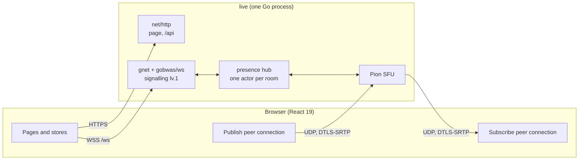

# Architecture

## Components



One binary, three listeners:

| Listener | Library | Carries |
| --- | --- | --- |
| HTTP (`PORT`) | `net/http` | the built client, `GET /api/rooms/{slug}`, `GET /api/lobby`, `GET /api/project`, `GET /api/pass/{id}`, `GET /up` |
| Signalling (`SIGNAL_PORT`) | [gnet](https://github.com/panjf2000/gnet) with [gobwas/ws](https://github.com/gobwas/ws) | WebSocket at `/ws`, subprotocol `lv.1`: presence, chat, whiteboard, owner actions, SDP and ICE |
| Media (`MEDIA_UDP_PORT`) | [Pion WebRTC](https://github.com/pion/webrtc) | RTP over DTLS-SRTP, straight from the browser to the server |

| Part | Choice | Why |
| --- | --- | --- |
| Media | Our own SFU on Pion, for every room | A mesh costs each person one upload per listener; a hosted SFU puts the media on someone else's server. |
| Signalling | gnet event loop | Holds many idle sockets cheaply. It carries signalling only; media and HTTP use the tools made for them. |
| Page and API | `net/http` | Nothing here needs more. |
| Client | React 19, Vite, TypeScript, Tailwind 4; no router, no state library | Three pages and one store per concern do not need them. |

## Server layout

The server follows ports and adapters; dependencies point inward.

```
server/
  cmd/live/                 the binary: starts the server through app/; `live audit` reads the audit trail
  app/                      composition root: reads and checks the environment once, wires everything
  core/room/                the Room aggregate: seats, flags, roster, owner rules. Pure: no clock, no I/O
  port/                     the coded error and its codes
  port/inbound|outbound/    what the application offers and what it needs
  service/presence/         the hub and one goroutine (actor) per room; liveness, handover, lobby summaries
  signal/                   lv.1 over WebSocket on gnet: frames, close codes, rate limits
  httpapi/                  JSON routes
  page/                     serves the built client with its security headers
  sfu/                      the Pion media engine
  handoff/                  hands rooms to the next process on a planned restart
  guestpass/                takes guest passes from a configured issuer
  audit/                    optional append-only audit trail
  clientinfo/               parses User-Agent and request headers for the audit trail
  github/                   the repository star count on the front page
  internal/integration/     end-to-end calls against a real server
```

- **One goroutine per room.** Every change to a room goes through its actor, in order; there are no locks around room state. The room is a value that is told the time and answers with what changed, so every presence rule is a plain unit test.
- **State as bits.** Seats are a `uint64` bitmap; what a participant has on (microphone, camera, screen, screen audio, hand, owner, unstable) is a `uint16` of flags.
- **Whole rosters, versioned.** Each change sends the entire roster with a version number, never a diff. A browser that missed a message is right again at the next one. A roster, chat message, photo or piece of the whiteboard sent to the whole room is encoded into one WebSocket frame once, and every connection queues those same bytes.
- **The lobby never waits.** Each room publishes an atomic summary; listing open rooms never blocks on a room's goroutine.

The client lives in `web/src`, one folder per concern (`room/`, `media/`, `signal/`, `session/`, `lobby/`, `board/`, `domain/`, `ui/`, `i18n/`). The design system, its tokens and shapes are in [`web/DESIGN.md`](../web/DESIGN.md).

## Protocol at a glance (`lv.1`)

JSON text frames over one WebSocket, each with a type in `t`.

| Direction | Frames |
| --- | --- |
| Browser to server | `join`, `resume`, `hb` (heartbeat), `leave`, `media`, `rtc` (SDP/ICE), `trouble` (a media trouble code from a fixed list, at most a few then one per 10 s), `look`, `photo`, `chat`, `board`, owner actions (`owner`, `remove`, `ban`, `transfer`, `listed`, `password`) |
| Server to browser | `joined` (seat, generation, resume secret), `roster` (versioned, whole), `rtc`, `chat`, `photo`, `board`, `error` |

Application close codes tell the browser why a socket ended: `4001` superseded by another tab, `4012` server restarting, `4400` bad frame, `4401` no hello, `4403` removed, `4404` banned, `4408` silent, `4409` too slow to read, `4429` flooding.

## Presence: no ghosts

The server is the only authority on who is present. It watches three signals: the socket, a heartbeat and the media path. At the first missed signal the others see the participant as *unstable*; after a 4 second grace they are *reconnecting*; a participant who does not come back is removed. Leaving on purpose is immediate.

A reload keeps the seat: the browser holds a per-room secret for the tab's lifetime and presents it to `resume`. The secret rotates on every resume and the old one is refused.

On a planned restart, a stopping server can write its rooms to a directory shared with the next one (`HANDOVER_DIR`); the new process adopts them and holds each seat for 12 seconds while the browsers reconnect. A crash loses the rooms.

## Media

- **Two peer connections per participant**: one to publish, one to receive everyone else. The server forwards RTP without decoding it and names each forwarded track by who sent it and what it is, from the sources the publisher declared (microphone, camera, screen, screen sound).
- **Publishing**: each source has one transceiver of its own for the life of the connection. Turning a source off empties its track and leaves it out of the declared sources; turning it on fills the same transceiver again. No m-line is ever rejected, so the BUNDLE transport never changes (Chrome tears it down when the first m-line is rejected) and no source can stream under another's name. An offer left unanswered for 10 seconds, or a publish connection that fails, makes the browser build a new one; the server replaces its side when the DTLS fingerprint changes.
- **Codecs** are Pion's defaults. Keyframes are asked for on demand: a subscriber's picture loss or full intra request reaches the publisher, at most once per 500 ms per stream, and a stream sent to someone new asks for one too. Retransmission is the server's own: each forwarded video stream keeps its last 256 packets once, however many subscribers it goes to, and answers their NACKs from that one history (on the RTX stream when negotiated), where Pion's responder kept 1024 full-size copies for every subscriber, the largest share of the server's heap. Asking publishers again for lost packets is the server's own too: it reads each sequence number straight from the packet and hands the interceptors after it one parsed header kept per stream, where Pion's generator allocated a map and a header for every packet. Pion's statistics interceptor is left out: the server never reads its own stats. On the forwarding path, a packet allocates nothing.
- **No simulcast and no forwarding on demand** yet: every stream goes to everyone at the quality it was sent.
- **Audio processing is in the browser only**: RNNoise for the strong voice filter, plus gain, a noise gate and echo cancellation. Background blur runs MediaPipe in the browser. The server never processes audio or video.
- **Media path**: one UDP port for everyone when `MEDIA_UDP_PORT` is set, announced at `MEDIA_PUBLIC_IP`. There is no TURN relay, so a network that blocks UDP cannot carry media.

## Whiteboard

Excalidraw, pinned and bundled, loaded only when opened. The board lives in the browsers; the server relays its pieces without reading them and keeps nothing, so it is gone when the room empties.
